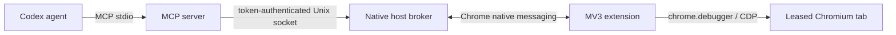

# Architecture

Chromex has three workspace packages and two local IPC boundaries.

## Package Ownership

| Package | Owns | Build output |
| --- | --- | --- |
| `@chromex/extension` | MV3 service worker, popup, extension-side protocol, static manifest | `packages/extension/dist` |
| `@chromex/mcp` | MCP server, browser controller, origin policy, broker client, native host, protocol schemas | `packages/mcp/dist` |
| `@chromex/plugin` | Codex metadata, skill assembly, runtime packaging, local installer | `packages/plugin/dist/chrome-browser-bridge` |

## Runtime Lifecycle

1. Chromium loads the unpacked extension.
2. The service worker connects to native host `io.codex.chrome_bridge`.
3. Chromium launches the registered native-host executable and passes the extension origin.
4. The native host verifies that origin, binds an owner-only Unix socket, and sends extension metadata to authenticated broker clients.
5. Codex starts the plugin's MCP server over stdio.
6. The MCP server reads the user-only token, authenticates to the broker, and exposes high-level tools.
7. Selecting a tab creates a client-owned lease before attaching `chrome.debugger`.
8. Releasing the tab or disconnecting the client detaches the debugger and clears its leases.

The extension never listens on a network port. The MCP server never exposes raw CDP as a tool.
