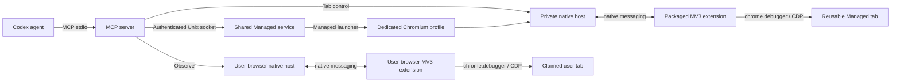

# Architecture

Chromex has three workspace packages. Managed Chromium is owned by a detached local service, shared across MCP clients.

## Package Ownership

| Package | Owns | Build output |
| --- | --- | --- |
| `@chromex/extension` | MV3 service worker, popup, extension-side protocol, static manifest | `packages/extension/dist` |
| `@chromex/mcp` | MCP server, browser controller, origin policy, broker client, native host, protocol schemas | `packages/mcp/dist` |
| `@chromex/plugin` | Codex metadata, skill assembly, runtime packaging, local installer | `packages/plugin/dist/chrome-browser-bridge` |

## Runtime Lifecycle

1. The agent starts the MCP server over stdio. Managed is the default and launches lazily on first browser operation.
2. Clients discover or start one shared service per canonical project/profile. Temporary browsers get unique IDs. A startup lock prevents duplicate services.
3. The detached service owns Chromium, its private bridge, profile lock, and diagnostics independently of agent lifetimes.
4. `observe: true` explicitly connects to the user's normal browser; only tabs enabled in the extension popup are visible or claimable.
5. Each bridge verifies the fixed extension origin, binds an owner-only Unix socket, and authenticates the MCP client with a user-only token.
6. Selecting the primary tab creates a client-owned lease before attaching `chrome.debugger`.
7. Release relinquishes the lease in either mode and leaves the tab open. A second agent can claim it by `browserId` and `tabId` and take a fresh snapshot.
8. MCP shutdown releases leases, leaving Chromium and tabs open. Closing Chromium ends the runtime after a 60-second diagnostic grace period; a browser operation during or after that period can restart the same profile. Recovery clears client selection and refs.

The local installer stores an allowlisted graphical-session environment beside the installed MCP
runtime. Managed launch merges that snapshot beneath the environment supplied by the current MCP
harness, so Codex, Claude Code, OpenCode, and other stdio clients use the same launch behavior even
when they filter `DISPLAY` or related variables.

Managed Chromium stdout and stderr are drained into a bounded in-memory diagnostic buffer. Early
launch failures include a concise safe tail, while `chrome_process_output` provides cursor-paged
access to retained output without writing logs to disk or mixing browser output into MCP JSON-RPC.

Neither extension listens on a network port. The MCP server never exposes raw CDP as a tool.

## Popup

The toolbar popup shows which clients are connected, the window and tab each one controls, and a
feed of recent bridge activity: client connects, window and tab lifecycle, debugger attach and
detach, and top-level navigations.

In the user's normal browser, **Allow agents on this tab** grants or revokes Observe access to the active tab. Managed browsers show their shared mode instead. Popup messages are accepted only from the extension's popup URL; no MCP tool can enable Observe.

The feed lives in `chrome.storage.session` rather than in the service worker, because MV3 suspends
the worker after roughly thirty seconds of inactivity and an in-memory log would not survive. Session
storage clears when the browser exits and never reaches disk. Recording an event never blocks or
fails a bridge operation.
