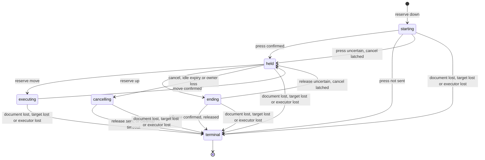
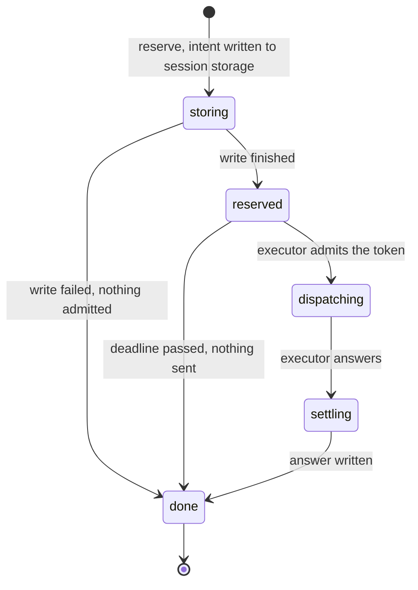
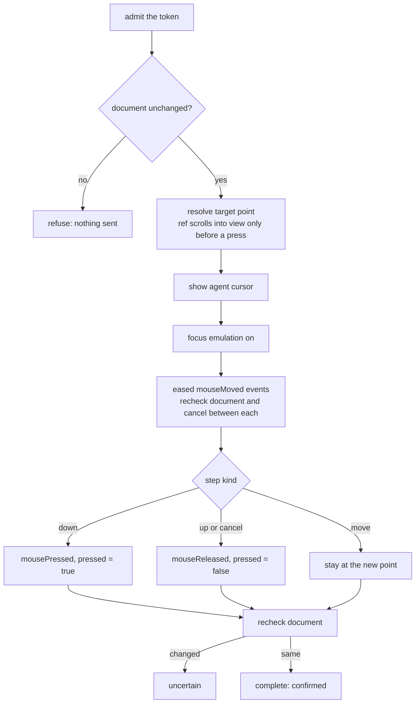

# Held gestures

A mouse press that is not yet released is the only state Chromex must never lose. One authority in the
extension worker (`GestureAuthority`) owns it. It allows one gesture per browser, stores each step
before anyone runs it, and releases a held button through the executor that pressed it.

`chrome_click` is a down and an up in a row. `chrome_mouse_down`, `chrome_mouse_move`,
`chrome_mouse_up` and `chrome_mouse_cancel` expose the steps. An unheld `chrome_mouse_move` is a
standalone move: it owns no button and ends after one answer.

## Gesture phases

`terminal` carries an outcome: `released`, `cancelled`, `moved` or `not-dispatched`. A standalone move
goes straight from `executing` to `terminal`.

## What ends a hold

| Cause | Detected by | Release sent? | Outcome |
| --- | --- | --- | --- |
| `chrome_mouse_up`, or the second half of `chrome_click` | The owner's `up` step | Yes | `released` |
| `chrome_mouse_cancel` | Owner's `gesture.cancel` | Yes, a `cancel` step through the original executor | `cancelled` |
| 120 s without a step or an inspection | Idle timer; a late step is refused as expired and latches cancel | Yes | `cancelled` |
| Owner disconnects, or revokes the Observe grant | `client.release`, `clientLost` | Yes, immediately | `cancelled` |
| Cleanup not answered in 10 s | Cleanup timer | Unconfirmed, with a warning | `cancelled` |
| Main-frame document replaced or rewritten | Debugger or pipe events, `documentLost` | No: the new document would get a stray release | `cancelled` |
| Tab closes or the debugger detaches | `targetLost` | No | `cancelled` |
| Pipe executor (service) disconnects | Native host lost, `clientLost(null)` | No | `cancelled` |
| Worker restarts | `restore` reads the stored record | No | `cancelled`, with a warning |

Only the owner's step, cancel or inspection renews the idle deadline. Reading status does not.

## One step

Each step goes through the same stored handshake. The executor is the worker for a web page and the
Managed service for a `chrome://` page.

- `reserve` checks the lease, the document, the sequence number and that no other step runs. A
  repeat of the last step with the same arguments returns the same receipt; the same number with
  other arguments is refused.
- `admit` refuses a step whose context went stale, and a step past the idle deadline.
- The executor answers `confirmed`, `not-dispatched` (it sent nothing) or `uncertain` (it cannot
  tell). `uncertain` keeps the hold, latches cancel and offers the release.

## Executor loop

A failure before any input is a refusal. After input may have reached the page, every failure is
`uncertain`. The pressed flag is set before the press event, so a lost reply still leaves a button the
cancel step will find and release.

## Where state lives

| State | Holder | Lost when |
| --- | --- | --- |
| Phase, deadline, step, outcome | `GestureAuthority`, copied to `chrome.storage.session` key `bridgeGesture` | Browser closes; a worker restart reads it and ends the gesture |
| Cursor, pressed button, focus emulation | The executor (`GestureState`) | The executor goes away; the authority then clears without claiming a release |
| Pipe page binding | Extension `pipeBindings`, service `pipeTabs` and `pipeSessions` | Service disconnect, page replacement or detach |

## Source

- `packages/extension/src/gesture-authority.ts` (phases, `reserve`, `admit`, `finish`, `latchCancel`, `terminate`, `clientLost`, `documentLost`, `targetLost`, `armIdle`, `armCleanup`)
- `packages/extension/src/gesture-storage.ts` (`GESTURE_KEY`, `parseRecord`, `view`)
- `packages/extension/src/browser-bridge.ts` (`gesture`, `runWorkerStep`, `onDebuggerEvent`, `onTabRemoved`, `releaseClient`)
- `packages/protocol/src/pointer.ts` (`runPointerStep`, `executeStep`, `readDocument`)
- `packages/mcp/src/service/pipe-input.ts` (`ServiceGestureExecutor`)
- `packages/mcp/src/server/browser-controller.ts` (`pointerStep`, `pointerCancel`)
