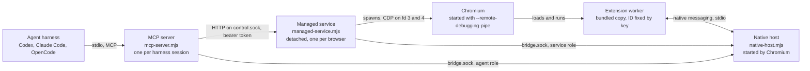
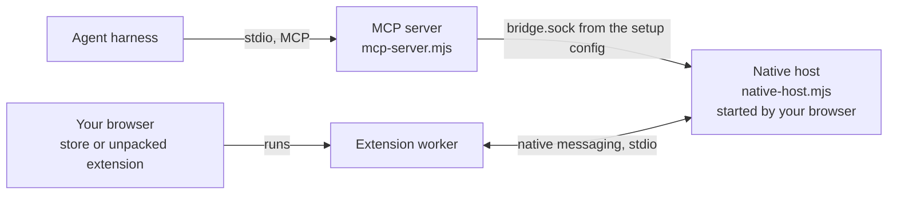
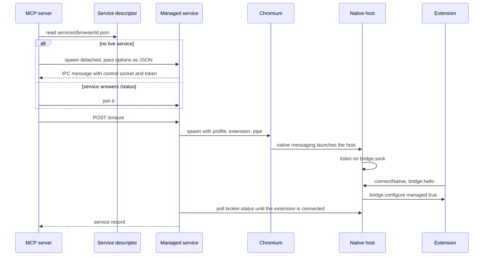

# Processes and transports

Chromex is four programs and three kinds of channel. Managed mode owns a browser and adds a
background service. Observe mode talks to the browser you already run.

## Managed

- The harness starts one MCP server per session. The server starts nothing until the first Managed
  tool call.
- The service owns Chromium, its CDP pipe and the profile lock. It outlives the MCP server, so
  agents in the same workspace and profile share one browser.
- Chromium starts the native host itself, through a private launcher the service wrote. The launcher
  sets the bridge config path and a service key. Only a client that presents that key gets the
  `service` role; every other client is an `agent`.
- Agents drive web pages through the extension's `chrome.debugger`. The service's pipe is for what the
  extension cannot reach: `chrome://` pages, Browser-level calls and shutdown.

## Observe

There is no service and no pipe. The extension serves only tabs you granted in its popup.

## Side by side

| | Managed | Observe |
| --- | --- | --- |
| Browser | Chromium that Chromex starts, own profile per workspace | The browser you use |
| Extension | Bundled, loaded with `--load-extension` | Store copy, or unpacked from the install folder |
| Native-host file | Private, written per launch | Written by `chromex setup` |
| Bridge config | `bridge-config.json` in the session folder, `managed: true` | `~/.config/chromex/config.json` |
| Page control | `chrome.debugger`; CDP pipe for `chrome://` | `chrome.debugger` on granted tabs only |
| Windows and tabs | Agent can create them | Agent cannot create windows, tabs or close tabs |
| Access rule | Every tab, one controller each | Per-tab grant in the popup |

## Who starts what

The server waits up to 25 s for a new service to report, and the service waits up to 15 s for the
extension to connect. The profile lock and a start lock stop two starters from launching two
browsers for one profile.

## Lifetimes

| Event | Result |
| --- | --- |
| MCP server exits or its client disconnects | Its leases are released. Chromium, tabs and the service stay. |
| All windows close, browser exits | The service keeps its record for 60 s so a retry reuses the runtime, then exits. |
| Native port disconnects | The extension reconnects with backoff up to 30 s, and an alarm retries every 30 s. |
| Internal `/shutdown` | Admitted only when no other client, lease, input or inspection exists. Then `Browser.close`. |

## Source

- `packages/mcp/src/server/server.ts`, `session-browser.ts`, `shared-browser.ts`
- `packages/mcp/src/service/managed-service.ts`, `managed-browser.ts`, `cdp-pipe.ts`
- `packages/mcp/src/native-host/index.ts`, `host.ts`
- `packages/mcp/src/shared/broker-client.ts`, `framing.ts`, `config.ts`, `paths.ts`
- `packages/extension/src/background.ts`, `native-connection.ts`, `browser-bridge.ts`
- `packages/protocol/src/rpc.ts`, `constants.ts`
