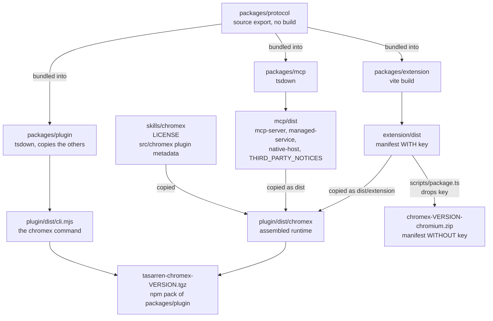
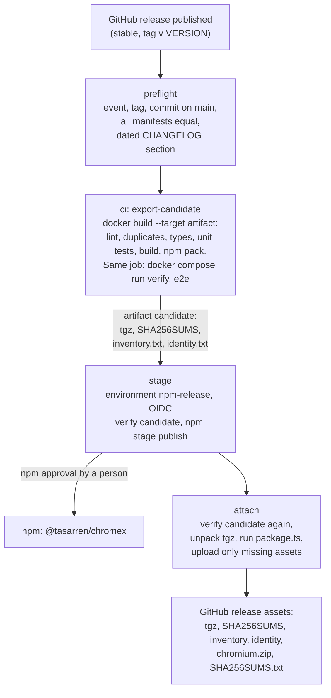

# Build and release

One source tree produces two artifacts for two audiences: an npm tarball that `chromex setup`
installs, and a zip of the extension without its manifest `key`, kept for a possible Chrome Web Store
listing. Both come from one build, so the zip is the same code as the one setup copies.

## Build outputs

| Output | Contains | Used by |
| --- | --- | --- |
| `packages/extension/dist` | The extension with the manifest `key`, which fixes the bundled extension's ID | Managed mode, and the unpacked Observe install |
| `packages/plugin/dist/chromex` | `dist/` with `mcp-server.mjs`, `managed-service.mjs`, `native-host.mjs`, `extension/`; `skills/chromex`; plugin metadata; `LICENSE`; third-party notices | Copied to `~/plugins/chromex` by setup |
| `packages/plugin/dist/cli.mjs` | The `chromex` command | `npx @tasarren/chromex` |
| `tasarren-chromex-<version>.tgz` | The two rows above | npm |
| `chromex-<version>-chromium.zip` | The extension files, with the manifest rewritten without `key` | A later store listing |

The store rejects a manifest `key`, and gives its item its own ID. The bundled copy keeps the `key`
because Managed mode loads it from disk and needs a known origin. The native-host file lists both
origins once the store ID is set.

## Release pipeline

- `stage` and `attach` each re-check the downloaded candidate against the producer's SHA-256, so the
  bytes that were tested are the bytes that publish.
- A green `stage` means *awaiting npm approval*, not published.
- `attach` builds the store zip from the **tarball's** extension folder, not from a fresh build, so the
  zip matches what npm users get.
- `attach` never replaces an asset. An existing asset must be byte-equal to the candidate.
- A manual `workflow_dispatch` runs the same `preflight` and `ci` (`verify`), and with
  `rehearse-stage` also `stage`, but never `attach`.

## Store listing later

There is no Chrome Web Store item for now. Observe users load the unpacked extension. The release
still attaches the store zip so a listing can be created later from the same bytes; nothing uploads
it. The first item, its listing and its privacy answers would be created by hand in the store
dashboard. [Release](../release.md#chrome-web-store) says what changes if that happens.

## Variables and secrets

| Name | Kind | Workflow | Where |
| --- | --- | --- | --- |
| `npm-release` | environment | `release.yml` `stage` | Publishes with an OIDC token. The approval gate is on npm, not in GitHub |

## Source

- `Dockerfile` (`app-build`, `artifact`)
- `.github/workflows/ci.yml`, `release.yml`
- `packages/plugin/scripts/verify-release.mjs`
- `packages/plugin/tsdown.config.ts`, `packages/mcp/tsdown.config.ts`, `packages/extension/vite.config.ts`
- `packages/extension/scripts/package.ts`
- `packages/protocol/src/rpc.ts` (`EXTENSION_ID`, `STORE_EXTENSION_ID`)
