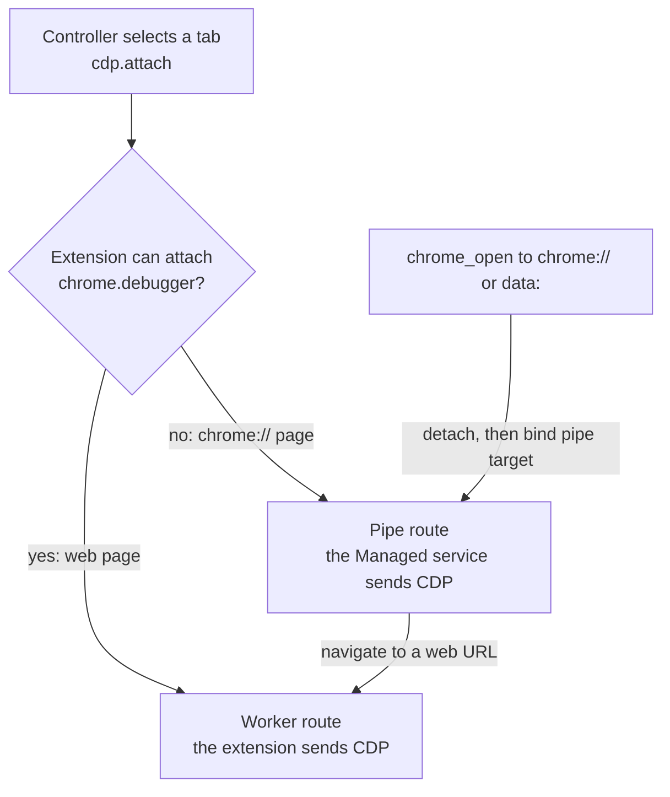
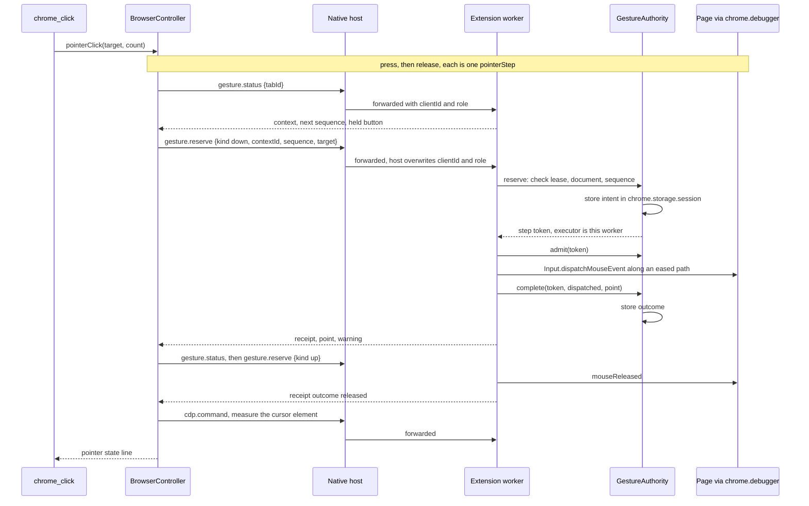
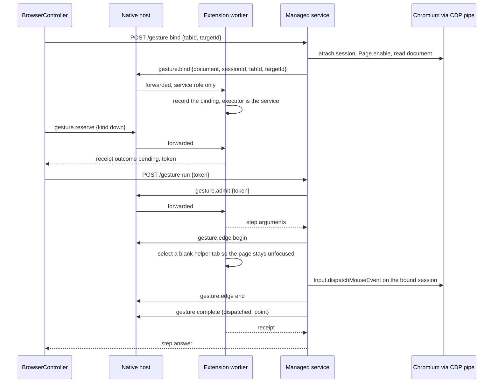
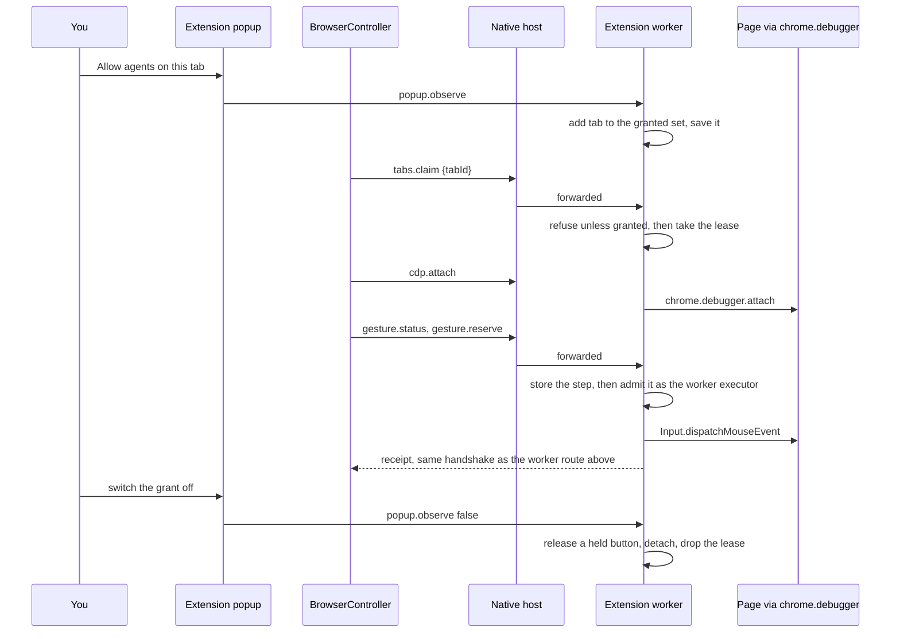

# One tool call

`chrome_click` is the example: it is a two-step gesture (press, release), so it shows every hop. Other
page tools take the same path with one broker request instead of two (`cdp.command`, or
`input.run` for typing and keys).

The diagrams start after the MCP server has joined a browser. The first call in a session also runs
the start-up in [Processes](processes.md#who-starts-what).

## Which route a tab takes

The pipe route exists only in Managed mode, because only the service holds Chromium's pipe. In
Observe there is no service, and `chrome://` pages are not reachable.

## Managed, web page (worker route)

- The host adds `clientId` and `clientRole` to every forwarded request and removes any the caller
  sent. Only methods in its allow-list pass.
- The authority stores a step before it runs. If the worker restarts, it finds the record, marks the
  gesture ended and sends no release.
- A document change between the check and the event turns the step into an uncertain one. The
  authority then holds the button and asks the executor to release it.

## Managed, `chrome://` page (pipe route)

- The service executes only the step the extension reserved. It never chooses a tab or a target.
- It counts document replacement and detach events for each bound session and reports them with
  `gesture.invalidate`. The extension then ends the binding.
- Plain commands on this route (snapshot reads, typing) use `input.reserve` and then
  `POST /cdp` or `POST /input` with the returned token. The service runs the one reserved command
  inside a fence, and the extension keeps the tab hidden from other clients until it ends.

## Observe, granted tab

- Every request on an ungranted tab fails with `Observe access disabled`.
- Observe cannot create windows or tabs, close tabs, or use the pipe route.
- Turning the grant off ends the lease at once. A held button is released through the executor that
  pressed it before the debugger detaches.

## Source

- `packages/mcp/src/server/tools.ts` (`chrome_click`, `pointer()`)
- `packages/mcp/src/server/browser-controller.ts` (`pointerClick`, `pointerStep`, `attach`, `cdp`, `input`)
- `packages/mcp/src/server/shared-browser.ts` (`callService`, `bind`, `gesture`, `cdp`, `input`)
- `packages/mcp/src/service/managed-service.ts` (`/gesture`, `/cdp`, `/input`, `bindGesture`, `watchPipe`)
- `packages/mcp/src/service/pipe-input.ts` (`ServiceGestureExecutor`)
- `packages/mcp/src/native-host/host.ts` (`FORWARDED_METHODS`, `fromClient`)
- `packages/extension/src/browser-bridge.ts` (`route`, `gesture`, `runWorkerStep`, `setObserve`)
- `packages/extension/src/gesture-authority.ts`
- `packages/protocol/src/pointer.ts` (`runPointerStep`, `executeStep`)
