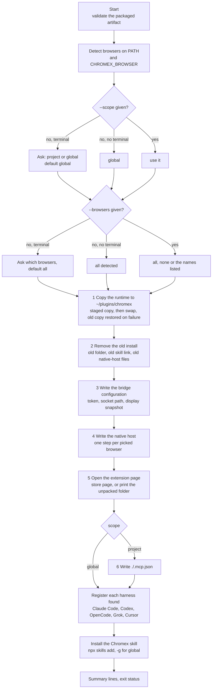
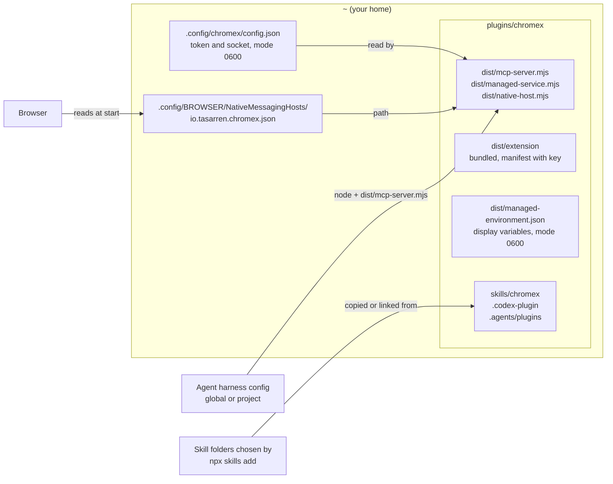
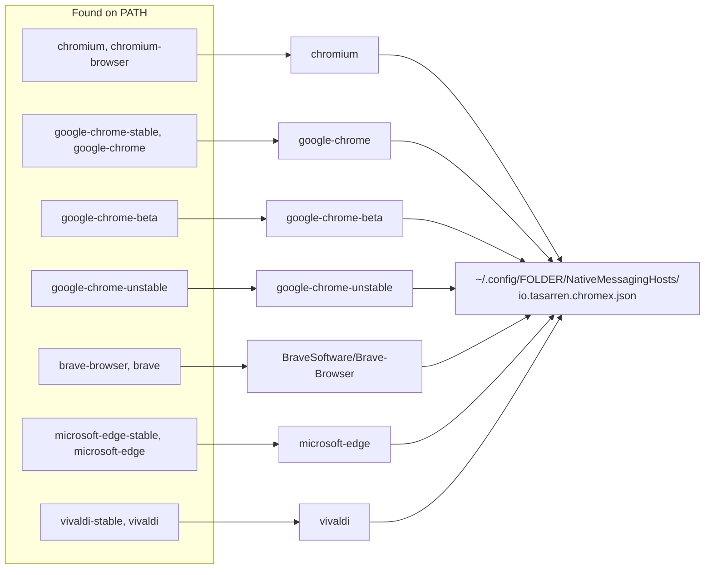
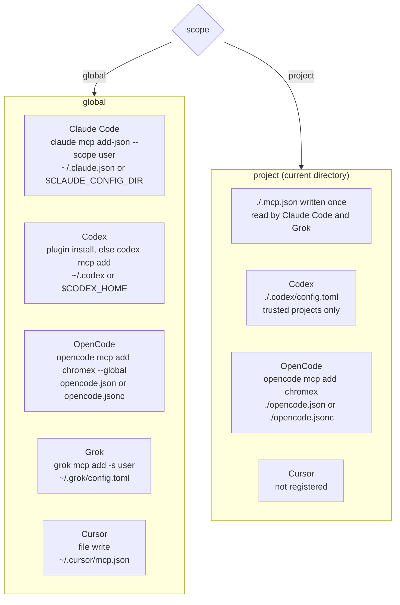
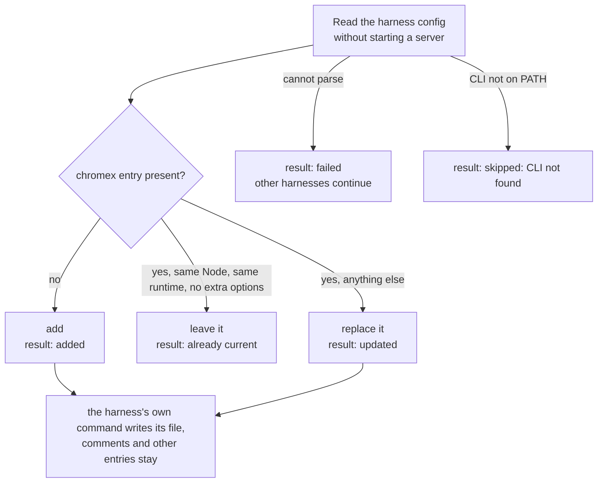

# Setup

`npx @tasarren/chromex setup` copies a runtime to a fixed folder, then points browsers and agent
harnesses at that copy. Nothing it writes depends on the `npx` cache, so removing the cache or moving
Node's temp folder does not break an install.

## Flow

Each box prints `[n/N] <action>...` and then `done`, `skipped: <reason>` or `warning: <text>`. The
total N is 10 (11 in project scope, which adds the `.mcp.json` step) plus one per picked browser, never
fewer than one, so it is known before the first step.

## What setup writes

| Written | Where | Notes |
| --- | --- | --- |
| Runtime | `~/plugins/chromex` | Replaced whole on every run. Mode of `native-host.mjs` is `0700`. |
| Bridge config | `~/.config/chromex/config.json` | Token is kept across runs when it is valid. `CHROMEX_CONFIG` moves it for the server. |
| Display snapshot | `~/plugins/chromex/dist/managed-environment.json` | `DISPLAY`, `WAYLAND_DISPLAY`, `XAUTHORITY`, `XDG_RUNTIME_DIR`, `DBUS_SESSION_BUS_ADDRESS` |
| Native-host file | `~/.config/<browser>/NativeMessagingHosts/io.tasarren.chromex.json` | One per picked browser; lists the bundled and, once set, the store extension origin |
| Harness entries | See below | Replaced if present |
| Skill | Folders the skills CLI picks | Project or global with `-g` |

## Browsers and native-host files

`CHROMEX_BROWSER` adds that executable as a `custom` browser; its folder follows the file name
(`beta`, `unstable`, `chrome` or `chromium`). `$XDG_CONFIG_HOME` replaces `~/.config`. A browser started
with its own `--user-data-dir` reads `<user-data-dir>/NativeMessagingHosts/` instead.

## Harness registration by scope

Every entry runs `node ~/plugins/chromex/dist/mcp-server.mjs` with the absolute Node path that ran
setup. For each harness setup reads the target, then:

Exceptions: setup edits Codex's project table, Cursor's `mcp.json` and the project `./.mcp.json`
itself and keeps their other keys. A Grok project entry is reported `covered by .mcp.json`. A project
`./.mcp.json` that cannot be parsed stops setup, because several harnesses share it.

## Exit status

Setup exits nonzero when any found harness fails, or the project `./.mcp.json` fails. A failed
skill install, an unopened store page, a missing CLI and a kept foreign file are warnings and leave
the exit status at zero.

## Source

- `packages/plugin/src/cli.ts` (arguments, usage)
- `packages/plugin/src/setup.ts` (`Installation.run`, `Steps`, `chooseScope`, `detectBrowsers`, `selectBrowsers`, `replaceInstalledPlugin`, `registerNativeHost`, `openStorePage`, `installSkills`)
- `packages/plugin/src/clients.ts` (`harnesses`, `ClientRegistrar.registerAll`, `registerProjectMcpJson`, `planServer`, one method per harness)
- `packages/protocol/src/constants.ts`, `rpc.ts` (`CONFIG_DIRECTORY`, `NATIVE_HOST_NAME`, `EXTENSION_ID`, `STORE_EXTENSION_ID`)
- `packages/plugin/tsdown.config.ts` (what the runtime folder contains)
