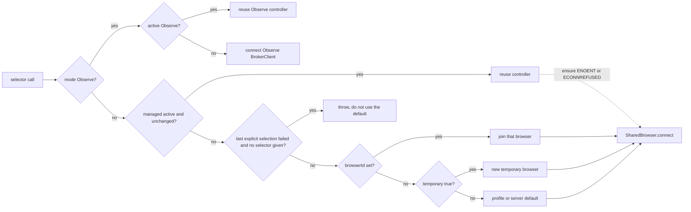

# Chromex public MCP tools

Source: `registerTools` in `packages/mcp/src/server/tools.ts` and the handlers it calls, read from the working tree. This describes that source, not the installed runtime. A built or installed server reflects its last build; [`docs/development.md`](../../docs/development.md#inspect-the-mcp-server) states the expected tool count for a built server.

Uncommitted files are candidate work. Run `git status --short` and `git diff HEAD -- <path>` before treating them as supported. Do not describe candidate or planned behavior as existing.

Update this file in the same change that adds, removes, or changes a tool name, parameter, default, result, or behavioral limit. Read the new facts from `registerTools` and the handlers it calls. A built server reflects the last build, not the working tree. [`docs/development.md`](../../docs/development.md#inspect-the-mcp-server) states the expected tool count for a built server; update that count there when the catalog changes.

`tools/list` returns each tool's JSON `inputSchema` and tool-level annotations. Defaults below are the Zod `.default(...)` calls in `registerTools`. This reference does not claim each of those becomes a `default` field in the listed schema. `chrome_help` is generated from the same registrations: names, parameter names, read/write kind, description, sorted, plus the workflow. Its text starts `Managed is default`.

## Result forms

Handlers wrap results three ways:

| Form | Tools | Body |
| --- | --- | --- |
| `json` | status, tabs, use_tab, open, extensions, process_output, navigate, viewport, measure, console, network | pretty-printed JSON text |
| `text` | snapshot, page text, help, pointer calls (`chrome_click`, `chrome_hover`, `chrome_scroll` and the mouse tools answer the pointer state line in Managed and Observe), and every other `run` success | plain text; `run` success is `ok` |
| image | screenshot | PNG content; plus a JSON text part when `path` is set |

`run` tools catch a throw and return `{ isError: true }` with `errorMessage(cause)`. `chrome_navigate`, `chrome_viewport`, and `chrome_extension_remove` return that same `isError` shape for their own validation failures. A tool that needs exactly one of two inputs answers `Provide exactly one of <a> or <b>.` from the `exactlyOne()` helper in `tools.ts`; the pointer controller throws the same text. The tool count is stated only by `chrome_help`. Other handlers do not catch. How the SDK surfaces an uncaught throw is not stated here.

## Selectors

`sessionOptions` is `browserId?`, `profile?`, `temporary?`. `connectionOptions` adds `observe?`. Only `chrome_status`, `chrome_tabs`, and `chrome_use_tab` take `connectionOptions`.

| Tool | Selector fields |
| --- | --- |
| `chrome_status`, `chrome_tabs`, `chrome_use_tab` | `browserId?`, `profile?`, `temporary?`, `observe?` (`use_tab` also requires `tabId`) |
| `chrome_open` | `browserId?`, `profile?`, `temporary?`. No `observe`. Handler calls `controller({ ...options, observe: false })` |
| `chrome_extension_install`, `chrome_extension_list`, `chrome_extension_remove` | `profile?` only. Handler forces `observe: false` |
| `chrome_process_output` and every page tool | none. They use the session already connected |

| Field | Format and effect |
| --- | --- |
| `browserId` | optional `^[A-Za-z0-9._-]{1,180}$`. Joins that existing Managed browser inside the server's own workspace. The record must name the same workspace and the same id. A supplied `profile` or `temporary` must match the record; an omitted one is not checked. A missing id throws `Managed browser ID is no longer available; reconnect using its profile` and does not create from profile (`shared-browser.ts` `connect`). |
| `profile` | optional `^[A-Za-z0-9._-]{1,64}$`, then `validateProfileName` also rejects `.` and `..` (`managed-browser.ts`). Shared persistent profile when `browserId` is omitted. Omitted profile uses the server default. |
| `temporary` | optional boolean. On a new Managed connection with no `browserId`, `temporary: true` creates a unique temporary browser. A later call that repeats the same selection, including `temporary: true` with no new `browserId`, reuses it. Keep the returned `managed.browserId` and pass it to rejoin. |
| `observe` | optional boolean, only on the three connection tools. User tabs with popup consent. `true` plus any Managed field throws `Observe cannot select a Managed browser or profile`. |

Omitted fields keep the session's active selection. `chrome_status({})` after Observe stays on Observe. A Managed field without `observe` selects Managed. A supplied field equal to the stored value does not change selection (`session-browser.ts` `controller`).

Switching to Observe closes the Managed session and clears the stored options. A later `observe: false` alone does not restore the earlier profile or `browserId`; that Managed call starts from the supplied fields or the server default.

A changed selection closes the current controller and clears the stored options before connecting, and they are stored again only after the connection succeeds. An unchanged call that reconnects after `ensure` throws `ENOENT` or `ECONNREFUSED` keeps the stored options. After an explicit `browserId`, `profile` or `temporary` selection fails inside `SharedBrowser.connect`, a later call that gives no selector throws `The last Managed browser selection failed; pass browserId, profile or temporary to choose one`. A failure earlier than `connect`, such as workspace resolution, does not latch. The latch stays through further failed explicit selections. It clears only after a `SharedBrowser.connect` succeeds, or when the call switches to Observe.

`SharedBrowser.connect` runs for a new Managed selection and when `ensure` on the active one throws `ENOENT` or `ECONNREFUSED`. An unchanged call while `this.managed` is set reuses it, except for that `ensure` failure. Its id is `browserId ?? (temporary ? randomUUID() : profile)`. A stopped descriptor restarts the profile the record names. A service whose pid is still alive but does not answer throws `Managed browser service is alive but unavailable; retry shortly` and does not start another. After connect, the session stores the record's `browserId`, `profile` and `temporary`, so the next identical `temporary: true` does not allocate another id.

*Selection in the working tree. Mode is chosen first. Observe reuses its controller or connects a new one. Managed reuses while active and unchanged, and connects again after that `ensure` failure. A failed explicit selection is not replaced by the default. `chrome_open` skips the Observe branch and forces Managed.*

## Lease

One client controls one tab. `tabs.claim` throws `Tab <id> is controlled by another client` when another client holds it. Re-claim by the same client refreshes. This client acts on its selected tab. `chrome_open` reuses that tab. `chrome_use_tab` without `inspect` releases this client's current lease first, then claims `tabId`; a failed claim leaves that lease released. With `inspect: true` it also releases that lease first, then reads a tab another client currently controls and takes no lease. A tab with no controller, or one this client already controls, is refused, and the released lease is not restored. Snapshot, text, screenshot, measure, viewport without a size and wait then read that inspected tab; the same tools read the controlled tab otherwise. Control is refused with `only inspected by this client`. Those page reads recheck the controller, so a handoff, revoke or close fails one midway. Console and network return the local buffer and do not recheck: they hold only events recorded since inspection began, or since the last navigation on a controlled tab. A pipe read is Managed only and only for a `chrome:`, `chrome-untrusted:` or `chrome-extension:` page; a parked ordinary tab with no debugger throws `Debugger is not attached`. Tab close and Observe revoke drop that tab's inspectors and pending reads. `chrome_close_tab` closes only a tab this client's `chrome_open` created. Claimed and user tabs are refused; release those with `chrome_release`. Release detaches and leaves the tab open. Observe cannot close tabs.

## Tools

Annotations: read = `readOnlyHint: true`. Write tools are not read-only. `chrome_extension_remove` and `chrome_close_tab` also set `destructiveHint: true`.

### Connection

| Tool | Parameters | Result | Limit |
| --- | --- | --- | --- |
| `chrome_status` | connection options | JSON: broker `callerOrigin`, `extension` (`extensionId`, `extensionVersion`, `name`, `protocolVersion`) or null, `socketPath`; plus `inspectedTabId`, `orphanedInput`, `parkedTabId`, `recoveryError`, `selectedTabId`, `windowId`, `mode`. Managed also adds `managed.browserId`, `joinedExisting`, `profile`, `temporary`, `workspace` (canonical root) and `pointer` (the pointer state line, a string) | Connects. Write annotation |
| `chrome_tabs` | connection options | JSON array of `{ id, title, url, windowId, active, controlled? }` | Observe lists popup-enabled tabs only |
| `chrome_use_tab` | connection options + required `tabId` (int, nonnegative); `inspect` boolean, source default `false` | that tab object | Without `inspect`, claim fails when another client holds the tab. With `inspect: true`, read-only on a tab another client controls. Observe needs popup consent |
| `chrome_open` | required `url`; `browserId?`, `profile?`, `temporary?` | tab object plus `joinedExisting` | Reuses this client's selected tab. Managed only |
| `chrome_release` | none | `ok` | Detach. Does not close the tab |
| `chrome_close_tab` | none | `ok` | Owned `chrome_open` tab only. Leaves a blank tab if it would be the last |

### Extensions (Managed profile)

| Tool | Parameters | Result | Limit |
| --- | --- | --- | --- |
| `chrome_extension_install` | required absolute `path`; `profile?` | `{ id, path, reloaded, otherClients }` | Whole profile. Same path reloads. `profile` switches this session |
| `chrome_extension_list` | `profile?` | `{ extensions: [{ id, name, path, version, enabled }], listed: string[] }` | `listed` is launch directories. Can start the browser |
| `chrome_extension_remove` | `path?` or `id?` (exactly one); `profile?` | `{ id, path, otherClients }` (`id`/`path` nullable) | Whole profile. Cannot remove Chromex itself. Destructive |

### Diagnostics

| Tool | Parameters | Result | Limit |
| --- | --- | --- | --- |
| `chrome_process_output` | `stream` `all`\|`stdout`\|`stderr` default `all`; `cursor?` positive int; `maxChars` int 500–100000 default 20000 | `{ process: { executable, args, pid, state, exitCode, signal, spawnError }, output: { stream, entries: [{ cursor, stream, text }], firstCursor, lastCursor, olderCursor, droppedBytes, retainedBytes, truncatedBefore } }` | Latest Managed launch. Omit `cursor` for the newest page; `olderCursor` pages backward. Read |
| `chrome_console` | `level` `error`\|`warn`\|`all` default `all` | `[{ level, text, ts, line?, source? }]` | Local buffer for the controlled tab since its last navigation, or for the inspected tab since inspection began. `error` keeps error/assert; `warn` also warning/warn. No console on `chrome://`. Read |
| `chrome_network` | `status` `failed`\|`all` default `failed` | up to 200 `{ url, method, status?, failure?, ms?, type? }` | Same local buffer: the controlled tab since its last navigation, reload, attach or release, or the inspected tab since inspection began. No network on `chrome://`. Read |
| `chrome_help` | none | text workflow plus sorted signatures | Starts `Managed is default`. Read |

### Page

Refs come from the latest `chrome_snapshot` and expire when the page changes. Read tools use the controlled tab, or the inspected tab while this client is inspecting. Mutation tools need the controlled tab and are refused on an inspected one.

| Tool | Parameters | Result | Limit |
| --- | --- | --- | --- |
| `chrome_navigate` | `url?` or `action` `back`\|`forward`\|`reload` (exactly one) | `{ url }` after load | `chrome://` is Managed only. History into an internal page from an extension-attached tab can detach it. Error text: `Provide exactly one of url or action.` |
| `chrome_snapshot` | `filter` `interactive`\|`all` default `interactive` | accessibility tree text | `all` includes decorative nodes. Read |
| `chrome_text` | `maxChars` int 500–200000 default 20000 | visible text; truncation note when cut | Read |
| `chrome_screenshot` | `path?` absolute `.png`, max 4096, no NUL; `clean` boolean default `false` | PNG image plus one text line from `formatScreenshotLine` (see below) | Parent must exist. `wx` flag: never overwrites. Mode `0600`. `clean` hides the agent cursor for the capture. Write |
| `chrome_viewport` | `width?` and `height?` together, each int 1–4096 | measure object; with a size, also `requested` and `matchesRequested` | Omit both to read. Display scale may round. Fresh snapshot after resize. Error: `Provide both width and height, or neither.` |
| `chrome_measure` | `refs` `/^e\d+$/` max 20 default `[]`; `selectors` each min 1 max 500, array max 20, default `[]`; `styles` each max 100 matching `/^(?:--[A-Za-z0-9_-]+|[a-z][a-z-]*)$/`, array max 20, default `[]` | `{ tabId, viewport, document, focus, elements, refs }` | Top document only. First selector match; miss is null. Missing ref throws. Read |
| `chrome_scroll` | `ref?` or complete `x`,`y`; `direction` `up`\|`down` default `down`; `amount` int 1–10000 default 600 | pointer state line | A ref scrolls that element into view and ignores direction/amount. `{x,y}` runs `chrome_mouse_move` there (outside the viewport is refused), then one `mouseWheel` at the point. Neither wheels at the cursor, or the viewport center before the first move. `ref` with `x`/`y`, one of `x`/`y`, or a held button (`Release the held button before scrolling`) is refused |
| `chrome_click` | one `ref` or complete `x`,`y`; `button` `left`\|`right` default `left`; `count` 1\|2 default 1 | pointer state line | Both targets, both buttons and both counts, in Managed and on a granted Observe tab. Does not bring the tab forward |
| `chrome_mouse_down` | one `ref` or complete `x`,`y`; `button` `left`\|`right` default `left` | pointer state line | Strict schema. Travels, presses, keeps the button held. Refused while this client holds |
| `chrome_mouse_move` | one `ref` or complete `x`,`y` | pointer state line | Strict schema. Without a hold the move is unheld; with one it drags |
| `chrome_mouse_up` | none | pointer state line | Strict schema. Releases at the last confirmed point; `No button is held` when nothing is held |
| `chrome_mouse_cancel` | none | pointer state line | Strict schema. Releases a held button and frees the tab; no-op line when none is held. Idle expiry is 120 s |
| `chrome_hover` | required `ref` | pointer state line | Shows the agent cursor |
| `chrome_type` | required `ref`, required `text`; `clear` boolean default true | `ok` | Focuses, optionally clears, then inserts |
| `chrome_select` | required `ref`, required `value` | `ok` | Matches value, label, or visible text |
| `chrome_press` | required `key` (min 1) | `ok` | Examples: Enter, Tab, Escape |
| `chrome_wait` | `text?`; `timeoutMs` int 100–120000 default 30000 | `ok` | Text: visible body contains it. No text: `document.readyState === complete`. Timeout throws. Read annotation |

`chrome_measure` object fields:

- `viewport`: `width`, `height`, `devicePixelRatio`, `visual` (`width`, `height`, `scale`) or null
- `document`: `clientWidth`, `clientHeight`, `scrollWidth`, `scrollHeight`, `scrollX`, `scrollY`, `overflowX`, `overflowY`
- `focus` and each element: `tag`, `id`, `role`, `label`, `focused`, `focusVisible`, `rect` (`x`, `y`, `width`, `height`, `top`, `right`, `bottom`, `left`), `styles`, or null
- `elements[]`: `{ selector, element }`
- `refs[]`: `{ ref, element }`

## Mouse gestures and cursor

The pointer tools have no Managed-only gate: `tools.ts` no longer defines `managed()` or the old Observe
refusal, `native-host/host.ts` forwards `gesture.*` in both modes, and `ExtensionBridge` draws and removes the
cursor in both. In Observe, `beginBackgroundInput` returns `null` before it reads the tab (DEC-86): input goes to the granted
tab as it is, selected or not, and Observe never opens or selects a tab. Revoke and tab close
call `gestures.clientLost(owner)` when `gestures.holds(tabId)`, so the original executor releases the held
button before the debugger detaches. An ungranted tab fails with the existing grant error; Observe never
starts a Managed browser.

No public schema has `contextId`, `sequence` or `gestureId`. `BrowserController` reads the authority's
context, next sequence and this client's own gesture (`gesture.status`) right before each step and sends
them on `gesture.reserve`. `chrome_mouse_cancel` sends `gesture.cancel` without an ID; the authority
resolves the caller's live gesture and answers no gesture when none is held. The authority's internal
sequence and duplicate handling are unchanged.

Pointer state line, from `formatPointerState` in `packages/protocol/src/cursor.ts`:
`cursor <x>,<y>|none held left|right|none viewport <w>x<h> scroll <x>,<y>`, rounded CSS pixels of the
main-frame viewport. `BrowserController.pointerState` reads `held` from `gesture.status` and the rest
from a `chrome_measure` of the cursor element. The mouse tools, Managed `chrome_click`, `chrome_hover`
and `chrome_scroll` return it as text, plus a second line when the executor gave a warning. A failed
step returns `isError` with the error and, when the page can be read, the line. `chrome_status` carries
the same line as `pointer`, or `none: <reason>` when the page cannot be read. A step that sent
nothing (`not-dispatched`) is an error.

Screenshot line, from `formatScreenshotLine` in `packages/protocol/src/cursor.ts`:
`png <w>x<h> css <w>x<h> scale <s> scroll <x>,<y> cursor <x>,<y>|none held left|right|none [path <file> bytes <n>] [mapping none]`.
`png` comes from the PNG header, `css`, `scroll` and `cursor` from one page read in the same inspection as the
capture (`inspection.ts`), `held` from `gesture.status` (`none` for inspectors). `scale` is `png width / css width`,
three decimals at most. When the PNG height differs from `css height * scale` by more than 1 px, `scale` is left out
and the line ends with `mapping none`. `clean` sets `visibility:hidden` on the cursor host after that read and clears
it in `finally`; a failed restore throws `The agent cursor stays hidden after the clean capture; the next pointer call
draws it again`.

Cancel, the 120-second idle expiry and controller loss release a held button through the original
executor and free the tab. An idle gesture expires without admitted owning movement or page
inspection; `chrome_status` polling does not renew it. A lost MCP client releases immediately. A lost
executor clears the reservation and reports that no release was sent. No uncertain reservation is
retained.

Only one held gesture is allowed per browser. A document replacement after a possible press stops
further input and reports a warning; the replacement document receives no blind release. The
controller then refuses the next move or up once with `The held gesture ended: <reason>`.

Every Managed pointer action (`chrome_click`, `chrome_hover` and the mouse verbs) draws an agent cursor
in isolated world `chromex-cursor`. It is `aria-hidden` under `documentElement`, so `chrome_snapshot`
and `chrome_text` do not show it; `chrome_screenshot` does. It marks only points whose input Chromium confirmed, travels by real
eased mouse-move input on the same document, and stays visible after the action. Idle is a blue arrow;
held is a red arrow with a ring. If the cursor cannot be drawn, a move, click or press is refused
before input; a release does not wait for it. Reduced motion does not change the pointer input.
