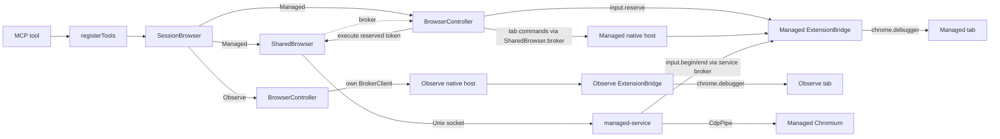

# Chromex Development

Work from the `chromex` workspace root. Keep package boundaries explicit and keep the root documentation synchronized with behavior.

## Route Changes

- Put shared wire constants, JSON-RPC envelope types and parsers in `packages/protocol` (private, browser-safe).
- Put MV3 service-worker, popup, and manifest changes in `packages/extension`.
- Put MCP tools, the native host, broker framing, CDP controller, policy, and tests in `packages/mcp`.
- Put plugin metadata, assembly, the `chromex` CLI, and setup (runtime copy, browsers, native host, store page, skill) in `packages/plugin` (public package `@tasarren/chromex`).
- Put human-facing explanations in `docs` and reusable agent instructions in `skills`.
- Define shared dependency versions only in the named catalogs in `pnpm-workspace.yaml`.

Read the relevant document before changing a boundary:

- Architecture and ownership: `docs/architecture.md`
- Commands and change workflow: `docs/development.md`
- Protocol behavior: `docs/protocol.md`
- Trust policy, CDP pipe and extension risks: `docs/security.md`
- Installation and update flow: `docs/installation.md`
- Failure diagnosis: `docs/troubleshooting.md`
- Agent-facing tool behavior: `docs/browser-tools.md`

## Find the Current API

Do not keep a fixed tool list here. [`API.md`](API.md) records the tool surface as read from the
working tree, which may differ from the last commit and from the installed runtime. Update `API.md`
in the same change that adds, removes, or changes a tool. Still confirm the working tree against
source before relying on either.

| Question | Source of truth |
| --- | --- |
| Tool names, parameter schemas, constraints, defaults, read/write annotations | `registerTools` in `packages/mcp/src/server/tools.ts` |
| Tool behavior and return shapes | Handler wrappers (`json`, `text`, `run`, screenshot content) in `tools.ts`; `SessionBrowser` in `packages/mcp/src/server/session-browser.ts`, `BrowserController` in `packages/mcp/src/server/browser-controller.ts` |
| Managed service routes and CDP pipe | `packages/mcp/src/service/managed-service.ts`, `packages/mcp/src/server/shared-browser.ts`, `packages/mcp/src/service/cdp-pipe.ts` |
| Leases, Observe grants, extension methods | `packages/extension/src/browser-bridge.ts`, `docs/protocol.md` |
| Gesture authority (internal, no public tool) | `packages/extension/src/gesture-authority.ts`; `gesture.*` dispatch in `browser-bridge.ts` |
| Wire format | Shared constants and envelopes in `packages/protocol/src/rpc.ts` and `constants.ts` (barrel `index.ts`); broker frames in `packages/mcp/src/shared/schema.ts` and `packages/mcp/src/native-host/host.ts` |
| Package ownership and runtime lifecycle | `docs/architecture.md` |
| Supported running server | `tools/list` and `chrome_help` via the CLI in [`docs/development.md`](../../docs/development.md#inspect-the-mcp-server) |

`tools/list` returns each tool's JSON `inputSchema` (constraints, and `default` fields only where the
listed schema actually contains them) and its tool-level
`annotations`. `chrome_help` is generated from the same registrations but lists only names,
parameter names, read/write kind and description, sorted, plus the workflow. The two surfaces
differ: `tools/list` is the schema; `chrome_help` is the short signature list and workflow, and
its result starts "Managed is default". A built server reflects the last build, not the working
tree. [`docs/development.md`](../../docs/development.md#inspect-the-mcp-server) currently states
the expected tool count for a built server; update that count there when the catalog changes.

`GestureAuthority` is internal extension state, not a tool. `ExtensionBridge` constructs it with an
injected clock and `chrome.storage.session`, and restores it before serving requests. It persists the
one gesture under `bridgeGesture` before a step can be admitted. The native host forwards `gesture.*`
only when its config is Managed. `registerTools` registers the four Managed mouse verbs and the
extended `chrome_click`; `chrome_help` states the tool count. The browser-side executor binds the
document and session for worker and Managed-service steps. Cancel, the 120-second idle expiry and
controller loss release a held button through the original executor and free the tab; no uncertain
reservation is retained. Every pointer action draws the agent cursor in isolated world
`chromex-cursor`; if it cannot draw, a move, click or press is refused before input, while a release
does not wait for it. A popup-granted Observe tab
uses the same pointer tools; revoke or tab close releases a held button. Not claimed: no-drop
cancellation and binding a screenshot to a pointer point. The agent-driven live check
(390, 1440, 1920 px) is in [`docs/development.md`](../../docs/development.md#tests).

The last commit is the baseline. Uncommitted changes are candidate work: run `git status --short`,
inspect modified files with `git diff HEAD -- <path>` and relevant untracked files directly (the
diff omits them). Working-tree `docs/architecture.md`, `docs/protocol.md` and
`docs/browser-tools.md` may describe candidate behavior; verify against source before relying on
them. Do not describe candidate work as supported until committed.

Tool call path (full runtime diagram in `docs/architecture.md`):

`SessionBrowser` constructs both controllers. Managed receives `SharedBrowser.broker`; SharedBrowser
does not construct the controller. Observe uses `new BrokerClient({ mode: "observe" })` and a
separate browser instance, so its native host and extension are not the Managed ones. Pipe input
is not controller-to-service alone: the controller asks the Managed extension to `input.reserve`
the lease, then `SharedBrowser` executes that token. Reservation precedes service begin. The
service calls `input.begin` through its own broker to activate the fence, the CDP pipe then runs
against Managed Chromium, and `input.end` finishes the fence only after confirmed completion.
An uncertain outcome can keep the fence.

## Implementation Workflow

1. Search the affected package and protocol callers before editing.
2. Preserve the extension ID, native-host name, protocol version, socket authentication, and lease ownership unless the requested change explicitly migrates them.
3. Add or update tests in `packages/mcp/test` for framing or policy behavior, and in `packages/extension/test` for service-worker, Observe consent, native-port, or popup-contract behavior.
4. Update documentation and the relevant skill when commands, tools, installation, or safety behavior changes.
5. Run `pnpm lint:fix` after editing.
6. Run `pnpm verify` (lint, duplicate scan, versions, types, tests, build); do not hand off a build that fails any stage.
7. Validate the assembled plugin and each changed skill with the repository's documented validation commands.

## Develop the Popup UI

Run plain `pnpm dev` from the workspace root. Vite opens `http://127.0.0.1:5173/popup.html`
on loopback, using the actual popup renderer and CSS. The labeled sample selector covers Observe,
Managed and empty/disconnected states. Actions affect sample state only; CSS updates in place and
source edits reload the page. Preview code is excluded from production builds.

For real extension changes, build and explicitly run local setup when requested, then reload
Observe at `chrome://extensions`. Updated Managed code requires the browser/service and MCP
restart sequence in [`docs/installation.md`](../../docs/installation.md#update); Vite does not
reload installed runtimes. Local commands use installed `pnpm` directly; Docker pins verification
executables.

## Inspect the Built Runtime

Run `pnpm build` first, then `pnpm inspect` for the pinned Inspector web UI. Open the printed
tokenized URL, connect the ad-hoc `node` STDIO server with its toggle, and do not share the token.
The CLI form and expected `initialize`, tool list, and `chrome_help` checks are in
[`docs/development.md`](../../docs/development.md#inspect-the-mcp-server).

## Local Plugin Update

Only when the user explicitly asks to update the installed runtime; a build or `pnpm verify` never
implies it:

1. Run `pnpm install:local` from the workspace root.
2. Confirm that Codex, Claude Code, OpenCode, Grok, and Cursor were configured or explicitly reported as missing.
3. Ask the user to start a new Codex thread.

Run setup from the graphical Linux session intended for Managed mode. It refreshes the
owner-only allowlisted display environment stored beside the installed MCP runtime.

Setup registers Codex through `codex plugin marketplace add` and `codex plugin add` when the CLI has
those commands, otherwise through `codex mcp add chromex -- <node> <runtime>`. It migrates only an
exact-owned legacy `chrome-browser-bridge` entry, and removes the old install folder, native-host files and skill link it wrote. Do not edit Codex, Claude Code, or OpenCode
configuration by hand; follow any manual step setup reports.

## Extension Handoff

Tell the user to load or reload `~/plugins/chromex/dist/extension` from `chrome://extensions` for
Observe. There is no Chrome Web Store item; setup prints that folder. Managed mode needs no GUI step.
